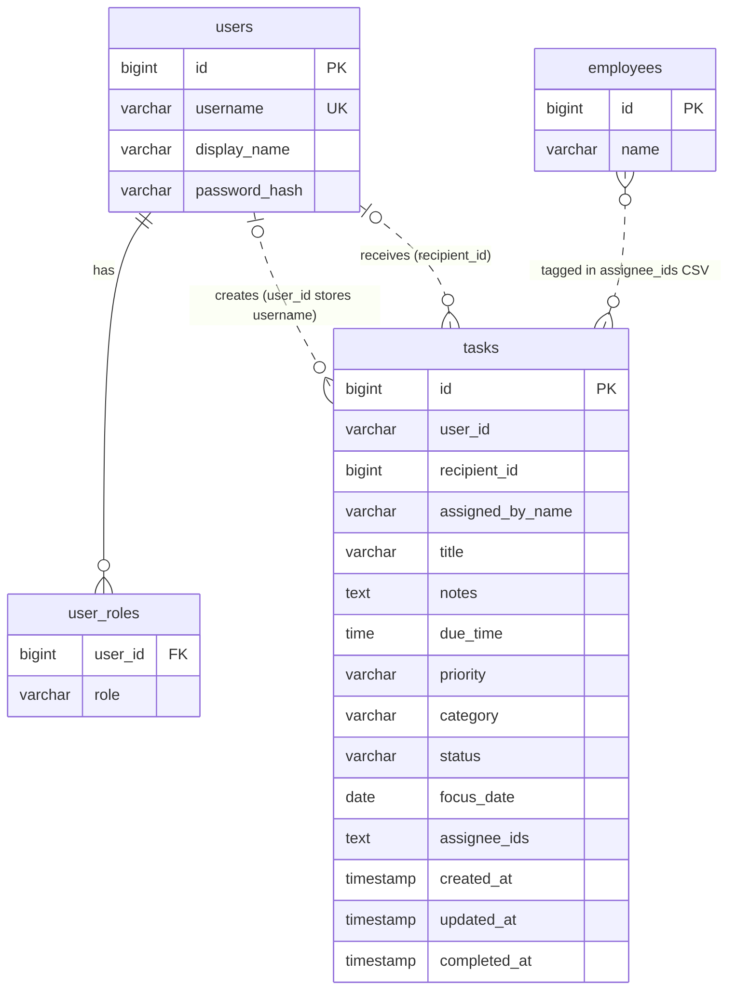

# Application schema design

This describes the schema implemented by the Spring Data JPA entities. MySQL 8.4 is the Compose database; the local profile uses H2. Flyway creates and versions the MySQL schema, while Hibernate validates it at startup. The local H2 profile still uses `ddl-auto=update`.

Solid line: JPA collection relationship. Dotted line: logical relationship handled by application code, with no declared database foreign key.

| Table | Purpose | Key rules |
| --- | --- | --- |
| `users` | Login accounts and display identity | `id` is generated; `username` is required and unique; `display_name` and `password_hash` are required. |
| `user_roles` | Roles assigned to each account | `user_id` references `users.id`; `role` is required. Roles: `SUPER_ADMIN`, `CHAIRMAN`, `VICE_PRESIDENT`, `MANAGING_DIRECTOR`, `DIRECTOR`, `ASSISTANT_VICE_PRESIDENT`. |
| `employees` | Directory entries used as task tags; employees cannot sign in | `id` is generated; `name` is required. |
| `tasks` | Personal and delegated work | `id` is generated; `user_id`, `title`, `priority`, `status`, `created_at`, and `updated_at` are required. Other columns are nullable. The converter writes `assignee_ids` as CSV text. |

`tasks.priority` is `HIGH`, `MEDIUM`, or `LOW`. `tasks.status` is `ACTIVE`, `IN_PROGRESS`, or `COMPLETED`. `focus_date` identifies a task pinned to a day; it is not a due date. `due_time` is a local clock time with no paired due date. `created_at`, `updated_at`, and `completed_at` are instants. `completed_at` records when the task was most recently completed, and is cleared when it is reopened. Calendar grouping uses Asia/Kolkata.

The task creator is stored in `tasks.user_id` as a username, despite the name. The optional `recipient_id` stores `users.id`; a recipient controls status. `assigned_by_name` keeps the creator's display name for delegated tasks. `assignee_ids` is a comma-separated list of employee IDs used only as tags. Application validation checks that tagged employees exist and rejects duplicates.

The backend defines indexes on `(tasks.user_id, tasks.status)` and `(tasks.recipient_id, tasks.status)`. It enforces a maximum of three open focused tasks per creator per date in application code. When an account username changes, its task `user_id` values are updated. When a manager is deleted, tasks they sent to another manager are transferred to the recipient; their other tasks are deleted. When an employee is deleted, its ID is removed from every task tag list.

## Design limits

- `tasks.user_id`, `recipient_id`, and `assignee_ids` lack database-enforced referential integrity. Direct database writes can create dangling references.
- The CSV tag list cannot be indexed or joined efficiently. A `task_employees(task_id, employee_id)` junction table is the natural migration if task volume or tag reporting grows.
- Existing MySQL databases created by Hibernate are marked at Flyway version 1 on first startup. Review the schema before that first migration-enabled deployment; future changes need migrations above version 1.
